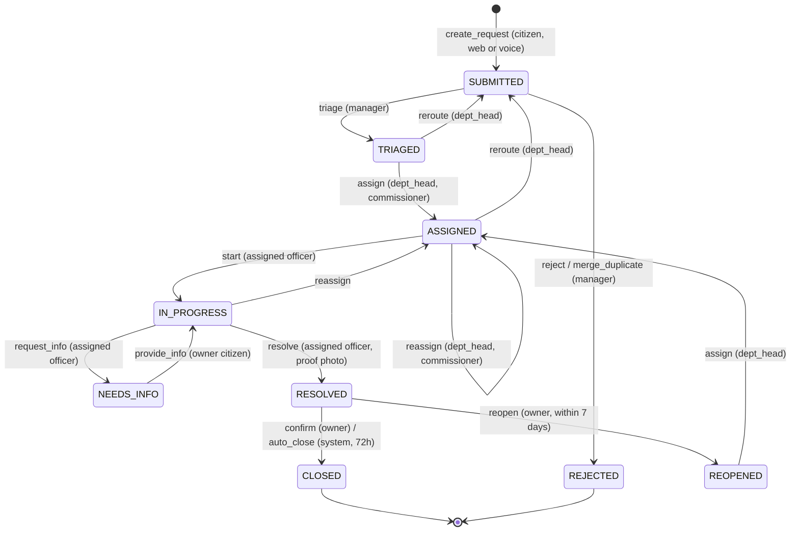

# Workflow engine

Source of truth: `config/workflow.yaml`. `npm run gen:workflow` writes `supabase/seed/01_workflow.sql`. The engine reads the `workflow_transitions` and `sla_policies` tables at runtime. Another track (electricity disputes, OPD) would be a new YAML file, not new engine code. Say this in the pitch.

## State diagram



## `transition_request()` contract

```sql
transition_request(
  p_request_id     uuid,
  p_action         text,
  p_expected_state request_state,   -- optimistic concurrency: refuse if the state changed underneath
  p_payload        jsonb default '{}',
  p_channel        channel default 'web',
  p_ai_suggestion_id uuid default null
) returns jsonb
-- success: { ok: true,  request: {...}, audit_id }
-- refusal: { ok: false, code, message, audit_id }
```

Order of checks (the first failure wins and is logged):

1. Request exists, else `NOT_FOUND`.
2. `state = p_expected_state`, else `STALE_STATE`.
3. A row exists in `workflow_transitions` for (`p_action`, current state), else `INVALID_TRANSITION`.
4. The caller's role is in `allowed_roles`, else `ROLE_NOT_PERMITTED`.
5. Every `requires` field is present and non-empty in the payload, else `MISSING_FIELD:<field>`.
6. Every guard passes, else `GUARD_FAILED:<guard>`.
7. Apply the state change and effects, insert an accepted audit row, insert notifications, return.

Every refusal returns a human message for the UI, for example:
- `INVALID_TRANSITION`: "Assigned → Closed isn't allowed. A request is closed only after the officer resolves it and the citizen confirms."
- `ROLE_NOT_PERMITTED`: "Only the assigned field officer can mark this resolved."
- `GUARD_FAILED:officer_covers_ward`: "Priya Kale doesn't cover Ward 7."
- `GUARD_FAILED:has_proof_photo`: "Add a photo of the completed work before marking it resolved."
- `GUARD_FAILED:within_reopen_window`: "This was resolved more than 7 days ago. Please file a new complaint."

## Guards

| Guard | Check |
|---|---|
| is_owner | `requests.citizen_id = auth.uid()` |
| is_assigned_officer | `requests.assigned_officer_id = auth.uid()` |
| is_department_head_of_request | Caller is dept_head and `profiles.department_code = requests.department_code` |
| is_department_head_of_request_or_commissioner | The above, or caller is commissioner |
| officer_in_department | Target officer's `department_code` = request's department |
| officer_covers_ward | (target officer, request ward) exists in `officer_wards` |
| different_officer | Target officer ≠ current officer |
| has_proof_photo | At least one `request_photos` row with `kind = 'proof'` for this request |
| within_reopen_window | `now_sim() - resolved_at ≤ reopen_window_hours` |
| resolved_longer_than_auto_close | `now_sim() - resolved_at ≥ auto_close_hours` |
| duplicate_target_is_open | The target request exists, isn't this one, and isn't CLOSED/REJECTED |

## Effects

| Effect | Does |
|---|---|
| set_department_from_category | From `categories.department_code`. For `other`, uses `payload.department_code` (required) |
| start_resolution_sla | Picks the latest `sla_policies` row for the category with `effective_from ≤ now_sim()` and stores `sla_policy_id`. Sets `sla_clock_start = submitted_at` and `resolution_due_at = submitted_at + hours` |
| fresh_resolution_sla | `sla_clock_start = now_sim()`, `paused_seconds = 0`, `resolution_due_at = now_sim() + hours`, `escalation_level = 0` |
| pause_sla | `paused_since = now_sim()` |
| resume_sla | `paused_seconds += now_sim() - paused_since`, `resolution_due_at += that`, `paused_since = null` |
| restart_triage_sla | `triage_due_at = now_sim() + triage_hours`, `triage_escalated_at = null` |
| clear_department / clear_assignment | Null the relevant columns |
| clear_resolution_sla | Null `sla_policy_id`, `sla_clock_start`, `resolution_due_at`; `escalation_level = 0` |
| link_duplicate | `duplicate_of = payload.duplicate_of` |
| post_citizen_message | Inserts the question or reply into `request_messages` (visibility `citizen`) |
| set_resolved_at / set_closed_at | Timestamps from `now_sim()` |
| increment_reopen_count | `+1` |

## SLA maths (all in SQL)

- `elapsed = now_sim() - sla_clock_start - paused_seconds - (now_sim() - paused_since if paused)`
- `ratio = elapsed / (resolution_due_at - sla_clock_start - paused_seconds)`
- `sla_status(request)` returns, in this order of precedence: `untriaged` (SUBMITTED), `paused` (NEEDS_INFO), `done` (RESOLVED/CLOSED/REJECTED), `breached` (ratio ≥ 1), `at_risk` (≥ 0.75), `on_track`.
- Triage SLA applies only while SUBMITTED: `triage_due_at = submitted_at + 4h`.

## Escalation sweep

`run_escalation_sweep()` is `SECURITY DEFINER` and idempotent. It runs:
- every minute via pg_cron,
- immediately after every Time Machine jump,
- every 30s from any open staff browser tab (harmless because it's idempotent; it covers venues where cron is unavailable).

For each non-terminal request:
1. SUBMITTED and `now_sim() ≥ triage_due_at` and `triage_escalated_at` is null → set `triage_escalated_at`, notify the Commissioner, audit `escalate` (stage `triage`).
2. Resolution stages: ratio ≥ 1.0 and `escalation_level` < 1 → level 1, notify the Dept Head and officer. Ratio ≥ 1.5 and level < 2 → level 2, notify the Commissioner.
3. RESOLVED and the auto-close guard passes → `auto_close` through the same transition path as actor `system`.

Triage escalation (`triage_escalated_at`) and resolution escalation (`escalation_level`) are tracked separately so a late triage doesn't swallow a later resolution breach. Within a stage the level only goes up, and each level is logged once. Escalation is a level, not a state: a request can be IN_PROGRESS and at L1. Escalation changes who is accountable, not where the work is.

## Engine tests (`npm run test:engine`, Vitest against the cloud project)

There is no local database, so tests share the cloud project with the demo. Each test creates its own requests, and the suite's `afterAll` calls `reset_demo()` (which also resets the sim clock and rewrites the audit genesis). Never run the suite while someone is presenting.


1. Citizen calls `triage` → `ROLE_NOT_PERMITTED`, refused audit row exists.
2. SUBMITTED → `resolve` → `INVALID_TRANSITION`.
3. `triage` without `category_code` → `MISSING_FIELD:category_code`.
4. `triage` with `other` and no `department_code` → `MISSING_FIELD:department_code`.
5. Assign an officer from another department → `GUARD_FAILED:officer_in_department`.
6. Assign Kale to a Ward 7 water request → `GUARD_FAILED:officer_covers_ward`.
7. Officer More calls `start` on Patil's request → `GUARD_FAILED:is_assigned_officer`.
8. `resolve` without a proof photo → `GUARD_FAILED:has_proof_photo`.
9. Ramesh confirms Sunita's request → `GUARD_FAILED:is_owner`.
10. Reopen after 8 sim days → `GUARD_FAILED:within_reopen_window`.
11. Wrong `expected_state` → `STALE_STATE`.
12. NEEDS_INFO for 5h shifts `resolution_due_at` by exactly 5h.
13. Sweep at +25h → L1 once. Running the sweep again creates no new events. At +37h → L2.
14. Untriaged at +4h → triage L1 to the Commissioner.
15. RESOLVED + 72h → auto_close by system.
16. `authenticated` direct UPDATE on `requests` → permission denied.
17. The `ai_writer` role UPDATE on `requests` → permission denied; INSERT into `ai_suggestions` → ok.
18. `verify_audit_chain()` ok; after `tamper_demo(id)` → `broken_at = id`.
19. Accepting an AI suggestion changes nothing on the request until a `triage` call references it.
20. With `demo_mode = false`: `time_machine_advance` and `tamper_demo` → refused.
